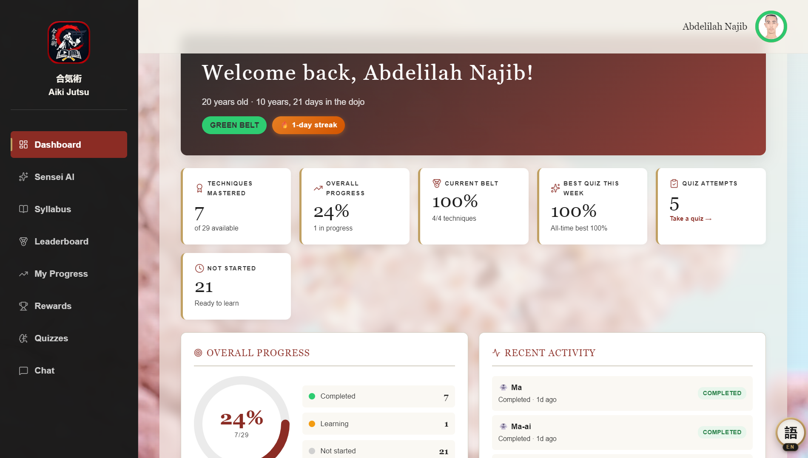
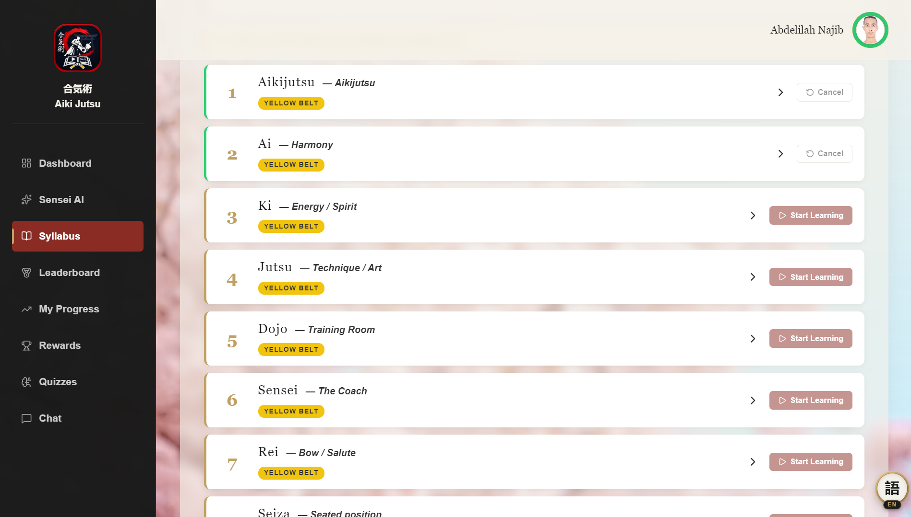
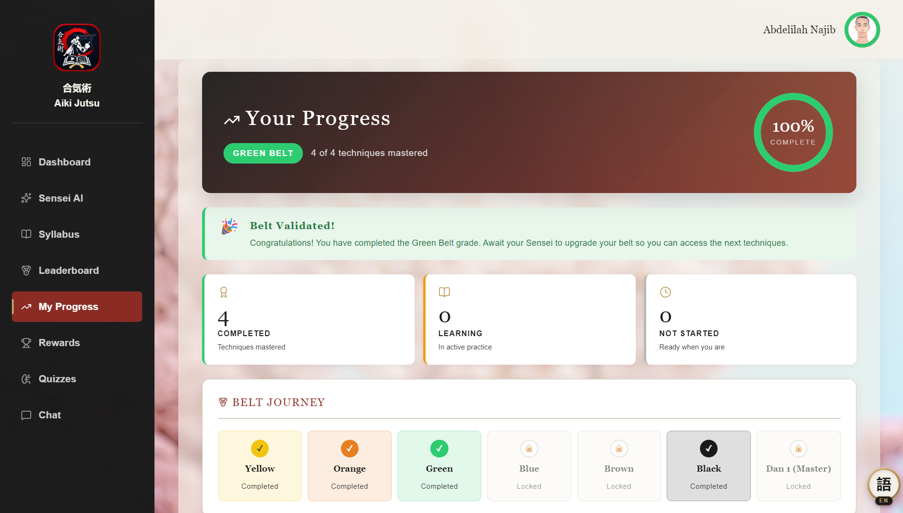
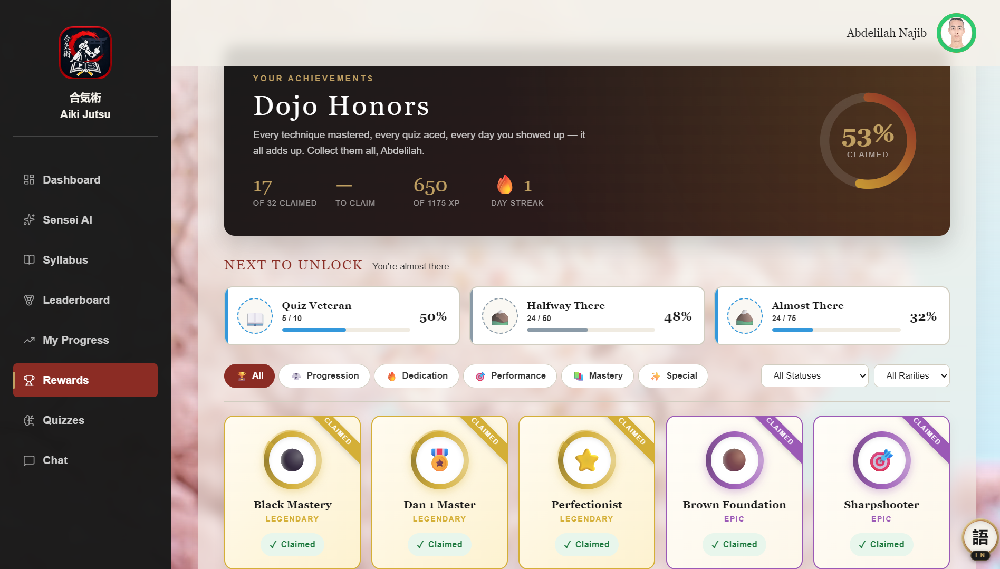
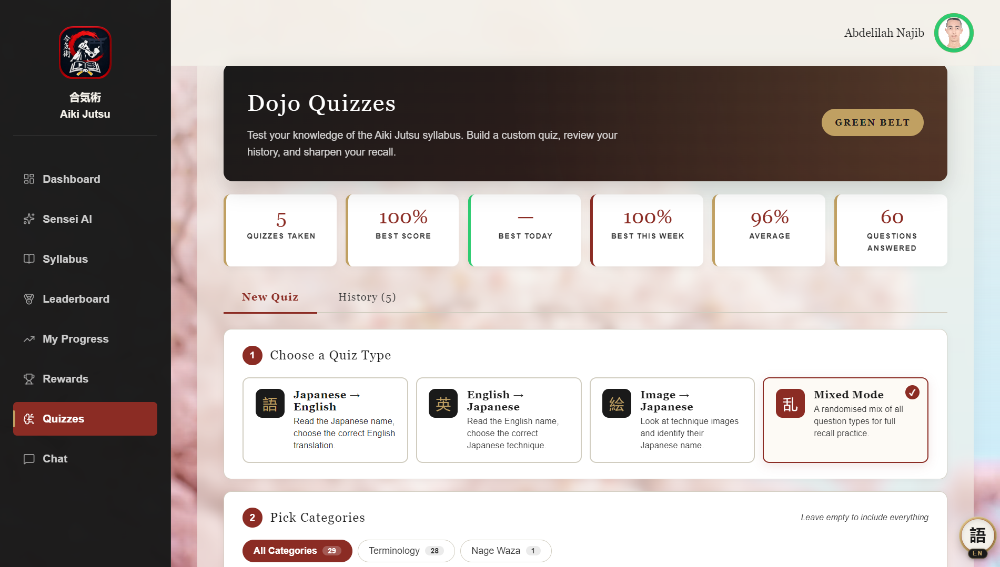
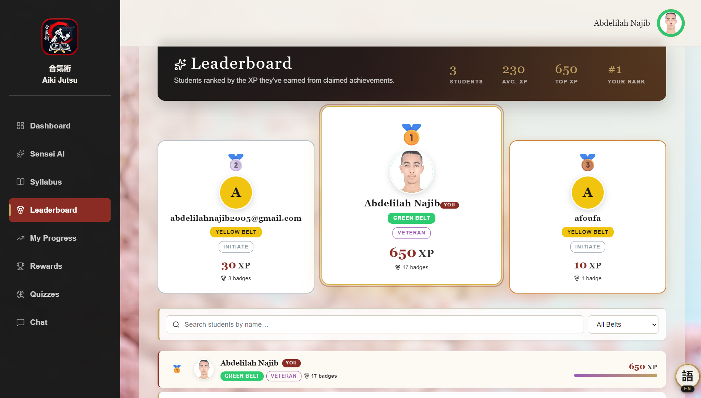
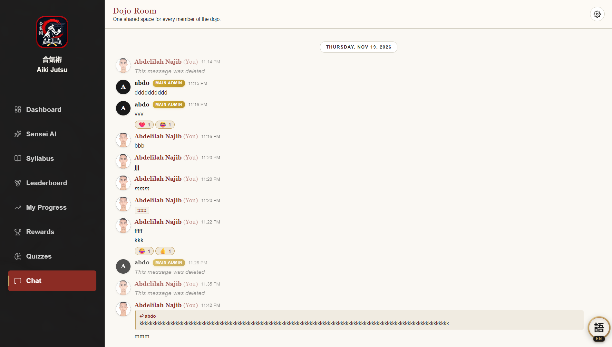
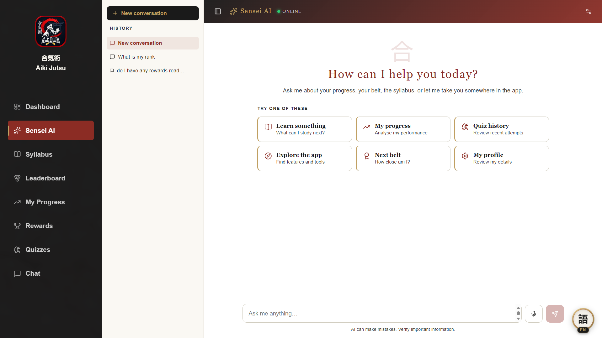
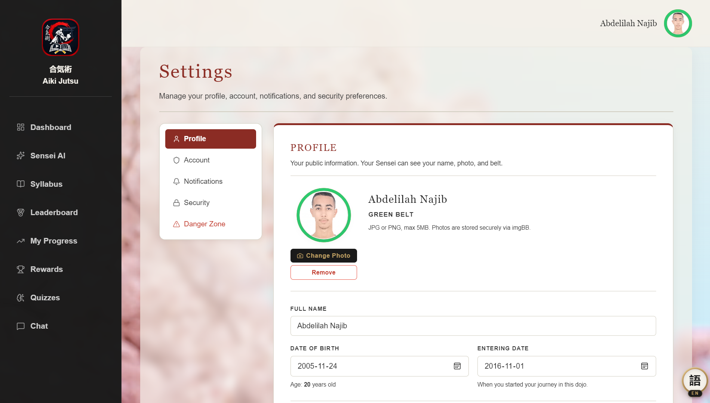

<div align="center">

# 🥋 Aiki Jutsu Platform

**A production-grade learning management platform for traditional Aiki Jutsu dojos.**

Built with React, Vite, Firebase, and a fully-featured real-time chat — designed from the ground up for multi-language learners, role-based administration, and modern PWA delivery.

[](https://react.dev)
[](https://vitejs.dev)
[](https://firebase.google.com)
[](https://www.i18next.com)
[](#-progressive-web-app)
[](#-license)

[Features](#-features) •
[Tech Stack](#-tech-stack) •
[Screenshots](#-screenshots) •
[Getting Started](#-getting-started) •
[Architecture](#-architecture) •
[Deployment](#-deployment)

</div>

---

## 📖 Overview

**Aiki Jutsu Platform** is a complete, self-hosted learning management system built specifically for martial arts dojos. It brings together curriculum delivery, belt progression, student administration, gamified motivation, and real-time community — all under a single, elegant, bilingual (English / French / Arabic with full RTL support) interface.

The platform is designed around a **belt-based curriculum model**: students progress through yellow, orange, green, blue, brown, and black belts, then graduate to Dan 1 (Master). Each technique is gated by belt rank, and every promotion requires explicit validation from a Sensei — mirroring the real-world dojo hierarchy.

Beyond the curriculum, the platform provides:

- 🧠 **Adaptive quizzing** with four question types (Japanese→English, English→Japanese, image→Japanese, mixed)
- 🏆 **An XP-based rewards system** with 32 badges across 6 categories and 4 rarity tiers
- 💬 **A full-featured, real-time chat room** with moderation, reactions, pins, reports, and rich media
- 🤖 **An AI study assistant** that can query the syllabus, track progress, and help students revise
- 📊 **Two distinct dashboards** — one for students, one for instructors — each with charts, leaderboards, and actionable insights

---

## ✨ Features

### 🎓 Student Experience

- **Belt-driven syllabus** — curriculum automatically filtered to a student's current belt and below
- **Progress tracking** — per-technique status (not started / learning / completed) with belt-wide completion %ages
- **Validation workflow** — students request belt validation when all techniques in their belt are complete; Sensei approves or rejects with a reason
- **Dan 1 graduation view** — a celebratory, letter-styled certificate displayed after the final black-belt validation
- **Rewards & XP** — earn badges for milestones (dedication streaks, quiz performance, belt mastery, syllabus completion); each badge awards XP by rarity
- **Leaderboard** — global XP ranking with per-belt ranking, tier system (Initiate → Legend), podium view, and personal position card
- **Quizzes** — configurable by type, category, and length; timer, live score, full review of past attempts
- **AI study assistant** — natural-language queries against the syllabus, progress summaries, and revision suggestions
- **Settings & profile** — avatar upload, birth date, dojo entry date, password change, account deactivation
- **Notifications** — belt approvals, rejections, new techniques, chat replies, mentions — all with an inbox + trash, bulk actions, and per-item delete/restore

### 💬 Real-Time Chat Room

- **Single shared room** for the entire dojo — everyone reads, everyone can participate
- **Rich messages** — text (with markdown: **bold**, *italic*, `code`), images (multi-image grid with lightbox), syllabus attachments (category or technique), and link previews
- **Replies** with quoted context and jump-to-original
- **Mentions** with autocomplete (`@Name`) and notifications
- **Reactions** — one emoji per user per message; live counts; replacing a reaction removes the previous one
- **Full moderation toolkit** for room admins:
  - Delete any message (soft delete with placeholder)
  - Block students for 24h / 7 days / forever (main admin protected)
  - Review reported messages (dismiss or block)
  - Pin up to 5 announcements
  - Close the room temporarily (students muted, admins still post)
  - View room health (total messages, deletions, active members, blocked count, pins)
  - Promote trusted students to **room admin** (separate role from dojo admin)
- **Read receipts** — batched, per-user timestamps; visible to author + room admins
- **Per-user color identity** — each member's name rendered in a unique, stable color derived from their UID
- **Swipe-to-reply** on mobile, long-press action sheet, hover dropdown on desktop
- **Automatic 30-day retention** — messages older than 30 days are cleaned up in batches on room-admin entry (Spark-plan friendly)
- **Optimistic send** — messages appear instantly with `sending…` state and retry on failure

### 🛠️ Admin Console

Five permission-gated panels, each independently toggleable per admin:

| Panel | Purpose |
|---|---|
| **Approvals** | Review new registrations, assign starting belts, approve or reject |
| **Validations** | Review belt-validation requests; approve, reject with reason, or revert a decision |
| **Students** | Full student roster with filters, per-student profile modal, edit, trash, restore, delete forever, and one-time credential creation via secondary Firebase app |
| **Manage Syllabus** | Drag-and-drop categories, soft-delete, restore, cascade-delete (also removes related techniques and progress) |
| **Manage Items** | Technique editor with per-category views, drag-to-reorder, quick-edit belt badges via a **radial menu**, and a full page-layout designer |

**Role hierarchy:**

- **Main Admin** — protected account (`isMainAdmin: true` in Firestore, Console-only), cannot be demoted or blocked, can manage all admins
- **Admin** — granular permissions (`approvals`, `validations`, `students`, `syllabus`, `admins`)
- **Room Admin** — a chat-specific role, independent of dojo admin, promotable only by the main admin
- **Student** — everything else

### 🌍 Internationalization

- **3 languages**: English, French, Arabic
- **Full RTL** — automatic `dir="rtl"` flipping on `<html>` when Arabic is selected; every layout, dropdown, tooltip, and animation is RTL-aware
- **~1,300 translation keys** across the UI
- **Dynamic direction flipping** — switch languages on the login page and watch the entire app re-orient without reload
- **Belt, notification, and admin-permission labels** all translated

### 📱 Progressive Web App

- **Installable** on desktop and mobile via a custom install prompt
- **Offline-capable** service worker with cache-first strategy for static assets and network-first for dynamic content
- **Home-screen icons** (192×192 and 512×512), theme color, app name, and standalone display mode
- **Custom install hooks** — `usePwaInstall` and `useInstallPrompt` for cross-browser install handling

### 📄 Public Marketing Site

- **Home** — hero, feature overview, screenshot carousel
- **How It Works** — step-by-step walkthrough of the student journey
- **About** — the dojo's philosophy and lineage
- **Contact** — WhatsApp QR code, direct contact form
- **Pricing** — multi-tier plans with a public (unauthenticated) read of the categories/items counts to drive the comparison

### 🎨 Design System

- **Washi / Sumi / Bengara / Gold** — traditional Japanese palette applied consistently
- **Custom typography** — serif headings (`Georgia`), sans-serif body (`Helvetica Neue`)
- **Rich animations** — modal entrances, badge celebrations with 56-piece confetti + shockwave rings, radial quick-edit belt picker, progress-ring fills, and more
- **Fully responsive** — three breakpoints: full sidebar (≥1025px), icon rail (601–1024px), off-canvas drawer (≤600px)
- **Dedicated loading component** with multiple spinner variants
- **Offline banner** — automatic `online`/`offline` detection with graceful degradation

---

## 🧰 Tech Stack

### Frontend

| Layer | Technology |
|---|---|
| Framework | React 18 (function components + hooks) |
| Build | Vite 5 |
| Routing | React Router 6 |
| State | Context API + local state |
| Styling | CSS Modules + CSS Variables |
| Icons | Lucide React |
| Drag & Drop | `@dnd-kit/core`, `@dnd-kit/sortable` |
| Emoji Picker | `emoji-picker-react` |

### Backend (Serverless)

| Layer | Technology |
|---|---|
| Auth | Firebase Authentication (email + password + verification) |
| Database | Cloud Firestore (NoSQL, real-time `onSnapshot`) |
| Rules | Firestore Security Rules v2 (role-based, main-admin protected) |
| Hosting | Firebase Hosting (optional) |
| File Uploads | imgBB API (client-side upload for images) |

### Internationalization & PWA

| Layer | Technology |
|---|---|
| i18n | `i18next` + `react-i18next` + `i18next-browser-languagedetector` |
| PWA | Custom service worker (`public/sw.js`) + web manifest |

### Development

| Tool | Purpose |
|---|---|
| ESLint | Linting |
| Vite Dev Server | Hot module reload |
| Git | Version control |

---

## 📸 Screenshots

<table>
  <tr>
    <td align="center"><strong>Dashboard</strong></td>
    <td align="center"><strong>Syllabus</strong></td>
    <td align="center"><strong>Progress</strong></td>
  </tr>
  <tr>
    <td></td>
    <td></td>
    <td></td>
  </tr>
  <tr>
    <td align="center"><strong>Rewards</strong></td>
    <td align="center"><strong>Quizzes</strong></td>
    <td align="center"><strong>Leaderboard</strong></td>
  </tr>
  <tr>
    <td></td>
    <td></td>
    <td></td>
  </tr>
  <tr>
    <td align="center"><strong>Chat</strong></td>
    <td align="center"><strong>AI Assistant</strong></td>
    <td align="center"><strong>Settings</strong></td>
  </tr>
  <tr>
    <td></td>
    <td></td>
    <td></td>
  </tr>
</table>

---

## 🚀 Getting Started

### Prerequisites

- **Node.js** ≥ 18.0.0 ([download](https://nodejs.org))
- **npm** ≥ 9 (bundled with Node)
- A **Firebase project** with Authentication + Firestore enabled
- A free **imgBB API key** ([get one](https://api.imgbb.com/))

### 1. Clone the repository

```bash
git clone https://github.com/YOUR_USERNAME/aiki-jutsu-platform.git
cd aiki-jutsu-platform
```

### 2. Install dependencies

```bash
npm install
```

### 3. Configure environment variables

Copy the template:

```bash
cp .env.example .env
```

Open `.env` and fill in:

```env
# imgBB API key — required for image uploads in chat, syllabus, and profile
VITE_IMGBB_API_KEY=your_imgbb_api_key_here
```

> 🔐 **Never commit `.env`** — it's ignored by `.gitignore`.

### 4. Configure Firebase

Open `src/firebase/config.js` and replace the `firebaseConfig` block with your own Firebase project credentials:

```javascript
const firebaseConfig = {
  apiKey: "YOUR_API_KEY",
  authDomain: "YOUR_PROJECT.firebaseapp.com",
  projectId: "YOUR_PROJECT",
  storageBucket: "YOUR_PROJECT.appspot.com",
  messagingSenderId: "YOUR_SENDER_ID",
  appId: "YOUR_APP_ID",
};
```

> ℹ️ Firebase client keys are **intentionally public** — they're shipped in every Firebase web app's built JS. Security is enforced by **Firestore Rules**, not by hiding the keys.

### 5. Deploy Firestore Rules

1. Open the [Firebase Console](https://console.firebase.google.com) → your project → **Firestore Database** → **Rules**
2. Paste the contents of `firestore.rules` (or your rules file)
3. Click **Publish** — wait for the green **"Rules published successfully"** toast

### 6. Set up the main admin account

In the Firebase Console → **Firestore** → `users` collection → open your user document → **Add field**:

```
isMainAdmin  |  boolean  |  true
```

This flag is **Console-only** and cannot be set from the app (rules block it). It's the single source of truth for who holds the highest privileges.

### 7. Run the dev server

```bash
npm run dev
```

Vite will print something like:

```
  ➜  Local:   http://localhost:5173/
  ➜  Network: http://192.168.1.x:5173/
```

Open the local URL in your browser.

### 8. Create your first dojo user

1. Register with a real email
2. Verify it via the link Firebase sends
3. Log back in — you'll be prompted to complete your profile
4. If you set `isMainAdmin` in step 6, you'll now have full admin access

---

## 🏗 Architecture

### Folder Structure

```
aiki-jutsu-platform/
├── public/                       # Static assets, service worker, PWA manifest
│   ├── sw.js                     # Service worker (cache strategy)
│   ├── manifest.json             # PWA manifest
│   └── icons...
│
├── src/
│   ├── components/               # Reusable UI components
│   │   ├── Layout.jsx            # Root shell (sidebar + header + outlet)
│   │   ├── LanguageSwitcher.jsx  # Floating draggable medallion
│   │   ├── Modal.jsx             # Generic confirm/info dialog
│   │   ├── StudentProfileModal.jsx
│   │   ├── ItemRenderer.jsx      # Model-B layout renderer
│   │   ├── ai/                   # AI assistant UI
│   │   └── ...
│   │
│   ├── context/
│   │   └── AuthContext.jsx       # Firebase auth bootstrap + user doc
│   │
│   ├── firebase/
│   │   └── config.js             # Firebase init
│   │
│   ├── hooks/
│   │   ├── useAIAgent.js         # AI conversation logic
│   │   ├── useInstallPrompt.js   # PWA install (mobile)
│   │   └── usePwaInstall.js      # PWA install (desktop)
│   │
│   ├── locales/                  # Translation JSON files
│   │   ├── en/{translation,chat}.json
│   │   ├── fr/{translation,chat}.json
│   │   └── ar/{translation,chat}.json
│   │
│   ├── pages/                    # Route-level components
│   │   ├── Login.jsx / Register.jsx
│   │   ├── Dashboard.jsx
│   │   ├── Syllabus.jsx / CategoryDetails.jsx / ItemDetail.jsx
│   │   ├── Progress.jsx / Rewards.jsx / Quizzes.jsx
│   │   ├── Competition.jsx
│   │   ├── Chat.jsx + chat/      # Chat room + sub-components
│   │   ├── AIAgent.jsx
│   │   ├── Settings.jsx
│   │   ├── Admin*.jsx            # Admin console pages
│   │   └── public/               # Marketing site
│   │
│   ├── services/ai/              # AI client + tool registry
│   │
│   ├── styles/
│   │   ├── global.css
│   │   └── variables.css
│   │
│   ├── utils/                    # Pure helpers
│   │   ├── badges.js             # Badge + XP logic (shared with Rewards + Chat)
│   │   ├── experience.js         # Belt ranks, colors, formatting
│   │   ├── defaultLayout.js      # Section types + default layouts
│   │   ├── chat.js               # Chat formatters, markdown renderer
│   │   ├── chatPermissions.js    # Role/action matrices
│   │   ├── chatCleanup.js        # 30-day message purge
│   │   ├── linkPreview.js        # Microlink + Google favicon fallback
│   │   ├── profanity.js          # Custom word/URL filter
│   │   ├── adminPermissions.js   # Dojo admin permission model
│   │   └── ...
│   │
│   ├── App.jsx                   # Route table + guard components
│   ├── i18n.js                   # i18next init + direction flipping
│   └── main.jsx                  # React entry point
│
├── .env.example                  # Template (safe to commit)
├── .gitignore
├── package.json
├── vite.config.js
└── README.md
```

### Data Model (Firestore)

| Collection | Purpose | Key fields |
|---|---|---|
| `users` | Every account | `role`, `belt`, `isApproved`, `isMainAdmin`, `roomAdmin`, `claimedBadges[]`, `chatLastSeenAt` |
| `categories` | Syllabus sections | `names.{en,ja,fr,ar}`, `order`, `isDeleted` |
| `items` | Techniques | `categoryId`, `names.*`, `minimumGrade`, `layout`, `order` |
| `progress` | Per-user progress | `userId`, `itemId`, `status`, `updatedAt` |
| `beltRequests` | Validation requests | `userId`, `belt`, `status`, `reviewedBy`, `rejectionReason` |
| `quizAttempts` | Quiz history | `userId`, `score`, `total`, `percentage`, `quizType`, `answers[]` |
| `notifications` | User inbox | `userId`, `type`, `titleKey`, `messageParams`, `messageId`, `read` |
| `messages` | Chat messages | `userId`, `text`, `imageUrls[]`, `syllabusRef`, `replyTo`, `readBy[]`, `readByAt{}`, `reactions{}`, `pinned` |
| `chatRooms/global` | Room metadata | `isClosed`, `pinnedMessageIds[]`, `lastMessageAt`, `messageCount` |
| `chatBans` | Active bans | `blockedUserId`, `blockedBy`, `expiresAt` |
| `chatReports` | Reported messages | `messageId`, `reporterId`, `status`, `reviewedBy` |
| `typing` | Transient typing state | `name`, `ts`, `clientTs` |

### Security Model

All access is enforced by **Firestore Security Rules v2**:

- **`isMainAdmin`** — Console-only flag; the app can never set or clear it
- **No one** can delete the main admin's user document — not even another admin
- **Disabling a main admin** — blocked at the rule level
- **Room admins** — cannot be blocked, cannot be promoted by anyone except the main admin
- **Message edits** — only within 5 minutes, own messages only
- **Message soft-deletes** — only within 10 minutes, own messages only; room admins bypass all time limits
- **Read receipts** — a user can only add/update their own `readBy` entry

---

## 🚢 Deployment

### Deploy to Firebase Hosting

```bash
# 1. Build the production bundle
npm run build

# 2. Install Firebase CLI (if not already installed)
npm install -g firebase-tools

# 3. Log in
firebase login

# 4. Initialize (only once — pick "Hosting" + your project)
firebase init hosting

# 5. Deploy
firebase deploy
```

The Firebase CLI will print your live URL when finished (typically `https://your-project.web.app`).

### Deploy Firestore Rules

```bash
firebase deploy --only firestore:rules
```

### Deploy to Vercel / Netlify (alternative)

Both work with the same build output:

```bash
npm run build
# Upload dist/ folder
```

For SPA routing, add a rewrite:

- **Vercel:** create `vercel.json` with `{ "rewrites": [{ "source": "/(.*)", "destination": "/" }] }`
- **Netlify:** create `_redirects` with `/*  /index.html  200`

---

## 🔧 Available Scripts

| Script | Description |
|---|---|
| `npm run dev` | Start Vite dev server on `http://localhost:5173` |
| `npm run build` | Production build to `dist/` |
| `npm run preview` | Locally preview the production build |
| `npm run lint` | Run ESLint over `src/` |

---

## 🌱 Browser Support

| Browser | Version |
|---|---|
| Chrome / Edge | Last 2 versions |
| Firefox | Last 2 versions |
| Safari | 15.4+ |
| iOS Safari | 15.4+ |
| Chrome Android | Last 2 versions |

Requires `color-mix()` CSS function support (or fallbacks will render at lower fidelity).

---

## 🤝 Contributing

This is a private project built for a specific dojo, but the architecture is designed to be extensible. If you're forking it for your own use:

1. **Fork** the repository
2. **Create a branch** for your change: `git checkout -b feature/your-feature`
3. **Follow the existing patterns** — CSS Modules, i18n for all user-facing text, Firestore Rules mirrored for every new collection
4. **Test in all 3 languages** before submitting — RTL breaks are the most common regression
5. **Open a pull request** describing what changed and why

### Code conventions

- **All user-facing text goes through `t()`** — no hardcoded strings
- **RTL overrides live in `[dir="rtl"]` blocks** at the bottom of each `.module.css`
- **New Firestore collections need rules** in `firestore.rules`
- **Never commit secrets** — use `.env` + `.env.example`
- **Badge/XP math lives in `utils/badges.js`** — single source of truth

---

## 🛣 Roadmap

- [ ] **Voice/video channels** in the chat room
- [ ] **Attendance tracking** with QR check-in
- [ ] **Multi-room chat** (one per belt or per category)
- [ ] **Exam mode** — formal belt exams with locked seats
- [ ] **Mobile app** — React Native wrapper with native push notifications
- [ ] **Class scheduling** — calendar with recurring sessions
- [ ] **Exportable progress reports** — PDF certificates per belt
- [ ] **Advanced AI agent** — voice conversation in French/Arabic
- [ ] **Stripe/Paddle integration** for the public pricing page

---

## 🐛 Known Issues / Limitations

- **imgBB free tier** — soft rate limits on bursts; not suitable for enterprise scale (migrate to Cloudinary or Firebase Storage at 500+ users)
- **Firestore Spark plan** — 50k reads / 20k writes / 20k deletes per day. The chat auto-cleans 30-day-old messages to stay within limits; heavy chat usage may require upgrading to Blaze (~$5–10/month)
- **Microlink link previews** — capped at 50 requests/day free; the code automatically falls back to Google favicon after that
- **No email delivery** for welcome messages — temporary passwords must be copied manually from the admin panel

---

## 📜 License

**MIT License** — see [`LICENSE`](LICENSE) for details.

You're free to fork, adapt, and deploy this for your own dojo. Attribution appreciated but not required.

---

## 🙏 Acknowledgements

- **[Lucide](https://lucide.dev)** — beautiful, consistent icon set
- **[emoji-picker-react](https://github.com/ealush/emoji-picker-react)** — full emoji library with search
- **[dnd-kit](https://dndkit.com)** — modern, accessible drag-and-drop
- **[Microlink](https://microlink.io)** — free link preview API
- **[imgBB](https://imgbb.com)** — free image hosting
- **Firebase** — auth, database, and hosting
- The **Aiki Jutsu** community — for inspiring a curriculum worth digitizing

---

<div align="center">

**Built with discipline, honor, and a bit of 合気道.**

🥋 *Aiki Jutsu — the art of harmony.*

</div>